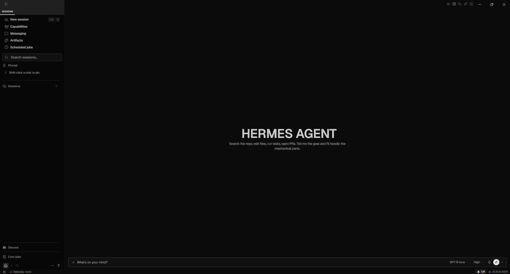

# Hermes Noir

**A near-black, monochrome restyle of the [Hermes Agent](https://github.com/NousResearch/hermes-agent) desktop app. By [Essam](https://essam.pro).**

Noir turns Hermes into a quiet, Vercel-style workspace: a near-black `#0b0b0b` canvas with a darker sidebar, white and grays only (color is kept for success, warning and error), Geist type, rounded Lucide icons, Claude-style chat bubbles and a live status line while the agent works.



It's a regular Hermes plugin. It never touches Hermes' own files, so `hermes update` keeps working and you can switch back to any other theme at any time.

## Install

Requires the Hermes desktop app. Noir is built against Hermes v0.21.5.

```bash
hermes plugins install mohamedessambarakat/hermes-noir
```

Then in Hermes: **Capabilities → Plugins → Hermes Noir → on**. The first time it loads, Noir switches you to the Noir theme once. After that, your theme choice is yours.

Or paste this link in your browser for a one-click install (Hermes shows a confirmation first):

```
hermes://plugin/install?repo=mohamedessambarakat/hermes-noir&enable=1
```

Recommended Hermes settings to go with it:

- **Settings → Appearance → Zoom**: 100%, for the intended sizes.
- `hermes config set display.timestamps true`: turns on the "just now" / "5m ago" labels next to message actions.

### Update

```bash
hermes plugins update hermes-noir
```

### Install a specific version

Every release is tagged on GitHub. To pin one, use its full commit SHA from the [releases page](https://github.com/mohamedessambarakat/hermes-noir/releases):

```bash
hermes plugins install mohamedessambarakat/hermes-noir --ref <commit-sha>
```

### Remove

```bash
hermes plugins remove hermes-noir
```

## What it changes

| Area | Change |
| --- | --- |
| Theme | **Noir · by Essam** in Settings → Appearance: near-black, monochrome, dark only |
| Type | Geist and Geist Mono, 15px chat text with a 1.6 line height |
| Icons | Hermes' sharp Codicons swapped for rounded Lucide icons |
| Sidebar | Darker than the chat, a visible search box, icons on every section, one flat Sessions list (no date groups), taller rows, hairline dividers, calm motion |
| Chat | Your messages as right-aligned bubbles; replies full-width on the left. Your messages are read-only (no click-to-edit, no restore button) |
| Message actions | Copy on your messages too; reply actions on the left; a "just now" / "5m ago" label beside them; all appear on hover |
| Status line | Above the input while a task runs: an animated spark, `1m 6s · 1.7k tokens · Running tools…` |
| Context ring | Next to the model picker, fills as the context window fills (amber at 75%, red at 90%). Click for a usage breakdown |
| Input | Solid, not see-through, with a border that brightens while you type |

Every visual change applies only while the Noir theme is selected. Pick another theme and Hermes looks stock again, with the plugin still installed.

With Windows "Animation effects" off (or macOS "Reduce motion" on), the status spark fades instead of spinning, and other motion is removed.

## If something looks off after a Hermes update

Noir restyles parts of Hermes that aren't a formal plugin API. When a Hermes update renames one of them, Noir shows a one-time notice ("N styling hooks changed…") and the affected piece falls back to Hermes' default look. Nothing breaks. Run `hermes plugins update hermes-noir`, or [open an issue](https://github.com/mohamedessambarakat/hermes-noir/issues) with your Hermes version (`hermes --version`).

## Develop

See [AGENTS.md](AGENTS.md) for how the plugin is structured and the rules for changing it.

```bash
npm install
npm run verify   # static checks + tests
```

## Credits

Made by [Essam](https://essam.pro). Icons: [Lucide](https://lucide.dev) (ISC). Fonts: [Geist](https://vercel.com/font) (SIL OFL 1.1), loaded from Google Fonts.

## License

[MIT](LICENSE) © Essam
